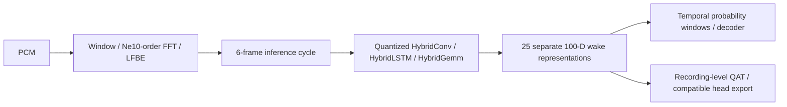

# Ben's Pryon reverse engineering and custom wake-word work

The original echo-dot-assist project turns an Echo into a Home Assistant satellite. This fork adds a subsequent
investigation: can its undocumented Pryon/NemoRT engine be understood closely enough to reproduce its streaming
inference and train compatible wake-word classifiers?

The strongest DSP measurement is **828/828 evaluated 64-bin frames, bit-identical at the normalized first-convolution
input**, with maximum error zero. Release preparation repeated the comparison against retained genuine-runtime
captures. It did not execute a fresh stock-runtime capture or establish every possible input/build is exact.



## Contributions and attribution

| Work | Attribution |
|---|---|
| Original Echo satellite, Home Assistant integration and platform | Julian Imhof / Gamer92000 and upstream contributors |
| Device unlock/bootloader/root foundation | Original authors credited by upstream, including R0rt1z2 |
| Pryon investigation, independently expressed runtime/DSP reconstruction, custom training and recovery feature | BenStein1, with AI implementation/analysis assistance |
| Mathematical/DSP primitives studied or ported | Kaldi, Ne10, OpenBLAS, Sun/FreeBSD msun, with retained notices |

This is binary-informed reverse engineering, not a clean-room or Amazon-source implementation. Upstream authorship
and history are preserved; this fork does not claim Ben created the original project.

## What was difficult and what was learned

An ONNX graph was only a starting point. Custom Hybrid operators quantize dynamically, arithmetic order changes int8
rounding, and one input drives 25 different recurrent histories. The final classifier consumes 25 separate 100-D
representations each cycle; flattening these into unrelated training examples loses the temporal decision rule.
The frontend required Ne10's FFT order and the measured float mel/log arithmetic rather than a generic log-mel helper.

Historical comparisons put LSTM X within 1.07e-6 over 133 cycles, classifier input within 2.4e-6 after warm-up, and wake
softmax within 1.8e-7. These are capture-specific numerical observations. Correcting affine BatchNorm rounding resolved
a known diagnostic discrepancy. Porting the device libm arithmetic prevented one-ulp host differences from amplifying
through optimization into different models. The portable math test pins FNV-1a `96594667583f1fd3`, not SHA-256.

QAT and preceding-dense adaptation were investigated, including failures. A small grouped validation study still
had 4/12 errors; better training loss did not prove better unseen speech recognition. A false accept reproduced in
the genuine engine was a classifier/generalization problem, not evidence that Amazon had a special timer trigger.
No universal arbitrary-phrase reliability or production readiness is claimed.

## Code and demonstrations available now

- [Runtime reconstruction, evidence ledger and firmware-independent tests](../tools/pryon-native/README.md).
- [Experimental on-device enrollment, packaging and lock-protected recovery](re-pryon-training.md).
- [Upstream research PR #171](https://github.com/Gamer92000/echo-dot-assist/pull/171), commit `dd56117`.
- [Upstream training PR #172](https://github.com/Gamer92000/echo-dot-assist/pull/172), commit `37b3c43`.

The PR branches remain intact and separate. This fork's `main` integrates both; upstream `main` had accepted neither
when checked for this publication pass. This is fork integration, not an upstream merge claim.

```sh
make unit-pryon_qat unit-enroll_ui
python3 -m unittest discover -s tools/pryon-native/tests
python3 tools/pryon-native/tests/test_pryon_runtime_capture.py
```

Install the declared reconstruction Python dependencies first. These are synthetic/contract checks, not a wake-word
accuracy demonstration. The published [standalone Pryon research](https://github.com/BenStein1/pryon-research) adds a firmware-free
DSP/QAT/decoder demo, a retained-capture comparison tool, exact source inventory and attribution. Its
[reviewed initial snapshot](https://github.com/BenStein1/pryon-research/commit/88487e58859db586681dd4b9bae1b5953981efd1)
passed [hosted synthetic CI](https://github.com/BenStein1/pryon-research/actions/runs/43215812663). That hosted run
contains no proprietary runtime or speech-accuracy evaluation.

## Hardware evidence and remaining tests

Earlier Dot 3 web enrollment trained and installed a compatible package locally. Later isolated hardware tests
confirmed root installation/checksum selection and recovery, including refusing to clear during a real root copy.
During this publication pass only a math probe was run on the device: the reconstructed functions and actual device
libm produced the same FNV hash, and before/after checks left protected files unchanged. No active configuration or
production service was changed.

Fresh microphone enrollment after the recovery revision, multiple speakers/rooms, other devices, and continuous
false-accept/miss measurements remain open. No weights, recordings or private runtime tensors are published, and
permission to redistribute Amazon-derived model packages has not been established.
